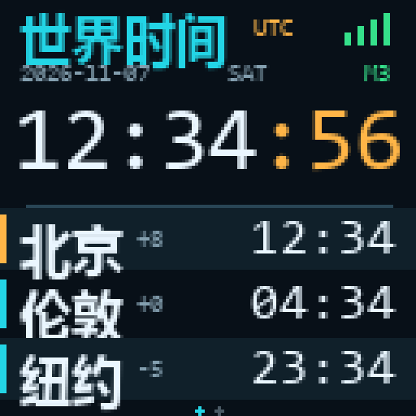
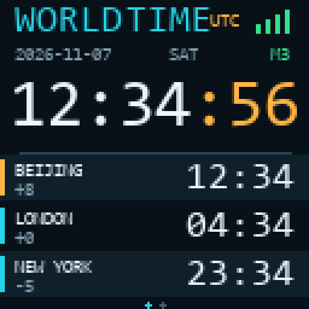

# M5Clock — AtomS3R × 3 Chain Mono World Clock

[中文](#中文) · [English](#english)

<p align="center">
  
  
</p>

<p align="center">
  
</p>

<p align="center">
  
</p>

---

## 中文

### 简介

M5Clock 是一个为 **M5Stack AtomS3R + Atomic toChain Base + 3× Chain Mono** 打造的完整世界时钟固件。

三个 8×8 单色点阵横向拼成 **24×8**，完整显示北京时间的 `HH:MM:SS`；AtomS3R 自带的 128×128 屏幕显示 UTC 时间，并轮播世界主要城市时间。

配网页和 AtomS3R 屏幕都支持 **中文 / English** 切换。

### 功能

- **三个 Chain Mono**
  - 24×8 点阵显示北京时间 `HH:MM:SS`
  - 每个模组负责 `HH:`、`MM:`、`SS`
  - 两位数字之间保留 1 列空白，读数更清楚
  - 前两组冒号每秒闪烁
  - 底部不再显示移动的秒点
- **AtomS3R 世界时钟**
  - 大字 UTC `HH:MM:SS`
  - UTC 日期、星期、检测到的 Mono 数量 `M3`
  - 城市时间两页轮播，每 7 秒自动翻页
    - 北京、伦敦、纽约
    - 洛杉矶、东京、悉尼
  - 自动处理伦敦/纽约/洛杉矶/悉尼夏令时
- **双语界面**
  - 配网页顶部可切换 **中文 / English**
  - AtomS3R 屏幕语言会同步切换，无需重新烧录
- **配网与对时**
  - 首次上电自动进入 AP 配网模式
  - 不写死 Wi-Fi 密码
  - NTP 自动对时
  - 支持 2.4GHz Wi-Fi
- **频谱字幕**
  - 最多 32 个 ASCII 字符
  - 直接显示在音乐频谱底部
  - 21 个字符以内居中，更长自动横向滚动
  - 三个 Chain Mono 不再显示字幕，始终显示时钟
- **点阵屏垂直位置**
  - 上方 / 下方（整体下移 1 行）
  - 只作用于 Chain Mono 时钟
- **音乐频谱**
  - AtomS3R 屏幕单独选择“世界时间 / 音乐频谱”
  - “S3R 同步切换”默认开启：Chain Mono 短按切到频谱时，S3R 自动切到频谱
  - 关闭后 S3R 保持当前界面，不跟随 Chain Mono
  - 三个 Chain Mono 可短按切换时钟 / 字幕 / 频谱
  - AtomS3R 显示 12 段彩色频谱：渐变柱、落峰、倒影、低频边框脉冲和 LIVE 指示
  - 没有电脑数据时显示待机起伏波形和 `NO PC`
  - 字幕整合在频谱底部，不再单独占一个界面
  - 默认使用 USB 电脑连接，不需要额外麦克风
  - 电脑端运行 `pc/m5clock_spectrum.py`，通过 USB 串口发送频谱
  - 也可以选 PDM 麦克风（M5Stack Unit Mini PDM），接 Grove Port A
  - ESP32-S3 只有 BLE，不支持 Classic Bluetooth / A2DP，所以不能直接接蓝牙音频
  - 没有电脑数据或麦克风时 S3R 显示 `NO PC` / `NO MIC`
- **点阵屏时区**
  - 配网页可选择点阵屏显示的地区时间：
    - 北京、伦敦、纽约、洛杉矶、东京、悉尼、UTC
    - 自定义 UTC+X：x 由用户输入，范围 -12 到 +14 的整数小时
  - 固定城市自动处理夏令时；自定义 UTC 偏移不使用夏令时
  - S3R 城市列表中，已选时区排第一，左侧小条为黄色；其他城市小条为蓝色
  - 选择 UTC 或自定义 UTC+X 时，北京默认排第一，小条为蓝色
  - S3R 的城市列表会按所选时区重排并高亮；UTC 大字时间和六城数据不变
- **滚屏速度**
  - 配网页可选择 慢 / 正常 / 快
  - 在 AtomS3R 上双击按键也可循环切换滚屏速度
- **交互**
  - 短按 AtomS3R 按键：切换 Chain Mono 的“时钟 / 字幕 / 频谱”
  - 双击 AtomS3R 按键：切换频谱字幕滚动速度
  - 世界时间页仍每 7 秒自动轮播
  - 长按 3 秒：清除 Wi-Fi 并重新进入配网模式
  - 配网页可设置 Mono 顺序、Mono 亮度、屏幕亮度

### 硬件

| 部件 | 说明 |
|---|---|
| AtomS3R | C126，ESP32-S3，8MB Flash + 8MB PSRAM |
| Atomic toChain Base | A163，Atom 转 Chain 总线底座 |
| Chain Mono ×3 | U217，8×8 单色点阵 |
| PDM 麦克风（可选） | M5Stack Unit Mini PDM，音乐频谱用 |

Chain 总线：

| 项目 | 值 |
|---|---|
| 波特率 | 115200，8N1 |
| AtomS3R RX | GPIO6 |
| AtomS3R TX | GPIO5 |
| 供电 | 由 Atomic toChain Base 提供 5V |

接线注意：

1. Atomic toChain Base 的三角形箭头应**远离** AtomS3R。
2. 用 Chain 线从 Base 依次串联 3 个 Chain Mono。
3. 默认 Chain ID1 → 左，ID2 → 中，ID3 → 右。
4. 如果顺序相反，在配网页把 **Mono order / Mono 顺序** 改成 **Right → Left / 右 → 左**。

音乐频谱有两种输入方式：

1. **USB 电脑（默认，推荐）**
   - AtomS3R 用 USB-C 连电脑
   - 电脑运行 `pc/m5clock_spectrum.py --port COMx`
   - 脚本抓取电脑正在播放的声音，通过 USB 串口发送 12 段频谱
   - 不需要额外硬件

2. **PDM 麦克风（可选）**
   - M5Stack Unit Mini PDM（SPM1423）或兼容 PDM 麦克风
   - 接到 Grove Port A
   - Data → G1（GPIO1）
   - Clock → G2（GPIO2）
   - 5V / GND 由 Grove 提供
   - 如果 Data/Clock 接反，频谱会没有反应，交换 G1/G2 即可

> 蓝牙音频不支持：ESP32-S3 只有 BLE，没有 Classic Bluetooth / A2DP。

### 烧录（M5Burner）

仓库内已经包含编译好的 8MB 整片镜像：

```text
firmware/M5Clock-AtomS3R-M5Burner.bin
SHA-256: 1c96cd076d992ba10919d1a7f211417a7a837dd8935fc85fc39d931b764f94ba
```

步骤：

1. 打开 M5Burner，进入 **Custom Firmware / 自定义固件**。
2. 选择 `firmware/M5Clock-AtomS3R-M5Burner.bin`。
3. 烧录地址：`0x0`。
4. Flash Size：`8MB`。
5. AtomS3R 进入下载模式：按住屏幕下方按键，直到内部绿色 LED 亮起后松开。
6. 点击 Burn，等待完成。

烧录完成后设备自动重启。

### 首次配网

1. 手机/电脑连接 Wi-Fi：`M5-Clock-XXXX`。
2. 浏览器打开：`http://192.168.4.1`。
3. 页面顶部选择 **中文 / English**。
4. 选择 2.4GHz Wi-Fi，输入密码。
5. 按需调整 Mono 顺序、Mono 亮度、屏幕亮度。
6. **AtomS3R 屏幕**选择“世界时间”或“音乐频谱”；再选择 **S3R 同步切换** 开 / 关。开启后 Chain Mono 切到频谱，S3R 也切到频谱。
7. 频谱字幕最多 32 个 ASCII 字符，显示在音乐频谱底部；音频来源选“USB 电脑”或“PDM 麦克风”。
8. 在“点阵屏时区”选择固定城市、UTC，或“自定义 UTC+X”；选择自定义时输入 -12 到 +14 的整数小时。
9. 选择点阵屏垂直位置（上方 / 下方）和字幕滚动速度。
10. 点击 **保存并连接 / Save & Connect**。

连接成功后，AtomS3R 屏幕会显示世界时间；三个 Chain Mono 显示北京时间。

也可以访问 `http://m5-clock-xxxx.local/` 再次进入设置页（取决于路由器是否支持 mDNS）。

### 显示说明

**三个 Chain Mono：**

```text
[ H H : ] [ M M : ] [ S S  ]
```

- 默认北京时间 UTC+8，可在配网页切换时区或自定义 UTC+X。
- 数字之间空 1 列；冒号在对应模组最右侧。
- 只接 1 或 2 个 Mono 时，自动降级显示 `HH` 或 `HH:MM`。
- 自定义字幕显示在音乐频谱底部；21 个字符以内居中，更长自动横向滚动。
- 配网页“点阵屏时区”可选择北京、伦敦、纽约、洛杉矶、东京、悉尼、UTC，或自定义 UTC+X。
- 短按 AtomS3R 按键可切换 Chain Mono 的“时钟 / 字幕 / 频谱”；S3R 的世界时间 / 频谱在配网页选择。
- 双击 AtomS3R 按键可循环切换滚屏速度（慢 / 正常 / 快）。
- 配网页“点阵屏垂直位置”可让 Chain Mono 时钟整体下移一行，或保持在上方。
- 音乐频谱默认用 USB 电脑连接；也可以选 PDM 麦克风。没有数据时 S3R 显示 `NO PC` / `NO MIC`。
- 蓝牙音频不支持：ESP32-S3 只有 BLE，没有 Classic Bluetooth / A2DP。

**电脑端：**

Windows 直接双击：

```text
pc/M5Clock-Spectrum.vbs
```

它在后台静默运行，不出现黑框，也不占任务栏。第一次运行会问一次是否设置开机自启，选“否”不会添加任何启动项。之后会自动安装依赖并检测串口。需要看日志时才用 `pc/M5Clock-Spectrum.bat`。

也可以手动运行 `pc/Install-Autostart.bat` 添加；取消用 `pc/Remove-Autostart.bat`。自启也是静默的。

也可以手动运行：

```bash
py -m pip install -r pc/requirements.txt
py pc/m5clock_spectrum.py
```

先关闭 Arduino 串口监视器和 M5Burner 的串口窗口。详细说明见 [`pc/README.md`](pc/README.md)。

**AtomS3R：**

- 屏幕语言跟随配网页选择。
- 中文：顶部 `世界时间`；英文：顶部 `WORLD TIME`。
- 中间为 UTC `HH:MM:SS`，秒为琥珀色。
- 下方三行城市时间，7 秒自动翻页。
- `M3` 绿色表示 3 个 Mono 正常；`M0` 红色表示没有检测到 Mono。

### 从源码构建

依赖：

- Arduino ESP32 Core **3.1.3**
- M5GFX **0.3.0** — https://github.com/m5stack/M5GFX
- M5Chain **1.0.11** — https://github.com/m5stack/M5Chain

Arduino IDE：

1. 开发板选择 **ESP32S3 Dev Module**。
2. 配置：
   - Flash Size: **8MB (64Mb)**
   - Partition Scheme: **8M with spiffs (3MB APP/1.5MB SPIFFS)**
   - PSRAM: **OPI PSRAM**
   - Flash Mode: **QIO 80MHz**
   - USB CDC On Boot: **Enabled**
   - CPU Frequency: **240MHz**
3. 安装 M5GFX / M5Chain。
4. 打开 `firmware/firmware.ino` 编译上传。

Arduino CLI：

```bash
arduino-cli compile \
  --fqbn "esp32:esp32:esp32s3:USBMode=hwcdc,CDCOnBoot=cdc,FlashSize=8M,PartitionScheme=default_8MB,PSRAM=opi,FlashMode=qio" \
  --libraries firmware/lib \
  firmware
```

PlatformIO 配置见 `firmware/platformio.ini`。把 M5GFX / M5Chain 放到 `firmware/lib` 下即可。

### 仓库结构

```text
.
├── firmware/
│   ├── M5Clock-AtomS3R-M5Burner.bin   # 预编译 M5Burner 8MB 镜像
│   ├── firmware.ino
│   ├── platformio.ini
│   ├── lib/README.md
│   └── src/
├── docs/
│   ├── s3r-zh.png
│   ├── s3r-en.png
│   ├── chain-mono.png
│   └── chain-text.png
├── tools/
│   ├── gen_font.py
│   ├── gen_text_font.py
│   ├── make_previews.py
│   ├── make_en_preview.py
│   ├── make_text_preview.py
│   └── mock_mono.py
├── CHANGELOG.md
├── RELEASE_NOTES.md
├── THIRD_PARTY_NOTICES.md
├── LICENSES/
│   ├── ADAFRUIT-GFX.txt
│   └── OFL-1.1.txt
├── LICENSE
└── README.md
```

### 常见问题

**屏幕不亮 / 花屏**

- 确认烧录地址是 `0x0`，Flash Size 为 8MB。
- AtomS3R 有 ST7735 / GC9107 两种屏幕批次，M5GFX 0.3.0 会自动识别。

**S3R 显示 `M0`**

- 检查 Base 方向、Chain 线、5V 供电。
- 确认接的是 Chain Mono，不是 Chain RGB / Chain Key。
- 检查是否使用底部 G5/G6。
- 在配网页切换 Mono 顺序。

**时间一直是 `--:--:--`**

- 确认使用 2.4GHz Wi-Fi。
- 检查路由器是否允许 UDP 123 出站。
- 长按按键 3 秒重新配网。

**烧录失败**

- 关闭 UiFlow2、串口监视器等占用 COM 口的程序。
- 重新进入下载模式。
- 更换 USB-C 数据线。

### 版本

- 固件版本：**1.4.0**
- 目标芯片：ESP32-S3（AtomS3R，8MB Flash + 8MB PSRAM）
- Arduino ESP32 Core：3.1.3
- M5GFX：0.3.0
- M5Chain：1.0.11

### 许可

MIT License。M5GFX、M5Chain 的版权归 M5Stack / lovyan03 所有，遵循其各自许可证。中文字库来自 Noto Sans SC Bold（SIL OFL 1.1），详见 `LICENSES/OFL-1.1.txt`。

---

## English

### Overview

M5Clock is a complete world-clock firmware for **M5Stack AtomS3R + Atomic toChain Base + 3× Chain Mono**.

Three 8×8 monochrome matrices form a **24×8** display and show Beijing time as `HH:MM:SS`. The AtomS3R 128×128 LCD shows UTC and rotates through major world cities.

Both the setup page and the AtomS3R screen support **Chinese / English**.

### Features

- **Three Chain Mono modules**
  - 24×8 Beijing time, `HH:MM:SS`
  - Module 1: `HH:`, module 2: `MM:`, module 3: `SS`
  - One-pixel gap between digits
  - Blinking colons on the first two modules
  - No moving seconds dot at the bottom
- **Spectrum subtitle**
  - Up to 32 ASCII characters
  - Displayed at the bottom of the music spectrum
  - Up to 21 characters are centered; longer text scrolls
  - The three Chain Mono modules always show the clock
- **Dot-matrix vertical position**
  - Top, or bottom (shifted down one row)
  - Applies to the Chain Mono clock
- **Music spectrum**
  - The AtomS3R screen switches between world clock and music spectrum
  - “Sync S3R screen” is on by default: switching Chain Mono to spectrum also switches the S3R
  - Turn it off to keep the S3R screen unchanged
  - The three Chain Mono modules switch clock / subtitle / spectrum with a short press
  - 12-band color spectrum on the AtomS3R 128×128 LCD
  - Gradient bars, falling peaks, reflection, bass pulse, and LIVE indicator
  - The subtitle is integrated into the bottom of the spectrum screen
  - Idle animation with `NO PC` when no data is available
  - USB PC mode by default; no extra microphone needed
  - Run `pc/m5clock_spectrum.py` on the PC; it sends spectrum data over USB serial
  - Optional PDM microphone (M5Stack Unit Mini PDM) on Grove Port A
  - ESP32-S3 is BLE-only, so Classic Bluetooth / A2DP audio is not supported
  - Shows `NO PC` / `NO MIC` when no data is available
- **Dot-matrix time zone**
  - Select the region shown on the three Chain Mono modules:
    - Beijing, London, New York, Los Angeles, Tokyo, Sydney, UTC
    - Custom UTC+X: enter an integer offset from -12 to +14 hours
  - Fixed cities use automatic DST; custom UTC offsets do not
  - On the S3R city list, the selected time zone is shown first with a yellow bar; other cities use blue
  - When UTC or custom UTC+X is selected, Beijing stays first with a blue bar
  - The S3R city list is reordered/highlighted, while the UTC clock and six-city data stay unchanged
- **Scroll speed**
  - Choose slow / normal / fast in the setup page
  - Double-click the AtomS3R button to cycle the scroll speed on-device
- **AtomS3R world clock**
  - Large UTC `HH:MM:SS`
  - UTC date, weekday, and detected Mono count `M3`
  - Two rotating city pages, 7 seconds each
    - Beijing, London, New York
    - Los Angeles, Tokyo, Sydney
  - Automatic DST for London, New York, Los Angeles, and Sydney
- **Bilingual UI**
  - Switch **中文 / English** on the setup page
  - The AtomS3R screen switches language immediately
- **Setup and time sync**
  - First boot opens an AP captive portal
  - No hard-coded Wi-Fi credentials
  - NTP synchronization
  - 2.4GHz Wi-Fi only
- **Controls**
  - Short press: switch the Chain Mono display between clock / subtitle / spectrum
  - Double-click: cycle the custom-text scroll speed
  - The world-clock page still rotates automatically every 7 seconds
  - Hold 3 seconds: clear Wi-Fi and re-enter setup
  - Configurable Mono order, Mono brightness, and LCD brightness

### Hardware

| Part | Notes |
|---|---|
| AtomS3R | C126, ESP32-S3, 8MB Flash + 8MB PSRAM |
| Atomic toChain Base | A163 |
| Chain Mono ×3 | U217, 8×8 monochrome |
| PDM microphone (optional) | M5Stack Unit Mini PDM, for music spectrum |

Chain bus:

| Item | Value |
|---|---|
| Baud | 115200, 8N1 |
| AtomS3R RX | GPIO6 |
| AtomS3R TX | GPIO5 |
| Power | 5V from Atomic toChain Base |

Wiring:

1. The triangle arrow on the base points **away** from the AtomS3R.
2. Daisy-chain the three Chain Mono modules from the base.
3. Default: Chain ID1 → left, ID2 → middle, ID3 → right.
4. If reversed, set **Mono order → Right → Left** in the setup page.

Music spectrum has two input options:

1. **USB PC (default, recommended)**
   - Connect the AtomS3R to the PC with USB-C
   - Run `pc/m5clock_spectrum.py --port COMx`
   - The script captures the PC's playback audio and sends 12 band levels over USB serial
   - No extra hardware

2. **PDM microphone (optional)**
   - M5Stack Unit Mini PDM (SPM1423) or compatible PDM microphone
   - Connect to Grove Port A
   - Data → G1 (GPIO1)
   - Clock → G2 (GPIO2)
   - 5V / GND from Grove
   - If Data/Clock are swapped, the spectrum stays flat; swap G1/G2

> Bluetooth audio is not supported: ESP32-S3 is BLE-only, with no Classic Bluetooth / A2DP.

### Flash with M5Burner

A prebuilt 8MB factory image is included:

```text
firmware/M5Clock-AtomS3R-M5Burner.bin
SHA-256: 1c96cd076d992ba10919d1a7f211417a7a837dd8935fc85fc39d931b764f94ba
```

1. Open M5Burner → **Custom Firmware**.
2. Select `firmware/M5Clock-AtomS3R-M5Burner.bin`.
3. Flash address: `0x0`.
4. Flash size: `8MB`.
5. Put the AtomS3R into download mode: hold the button until the internal green LED turns on, then release.
6. Click **Burn**.

### First-time setup

1. Connect to Wi-Fi `M5-Clock-XXXX`.
2. Open `http://192.168.4.1`.
3. Choose **中文 / English** at the top.
4. Select a 2.4GHz Wi-Fi network and enter the password.
5. Adjust Mono order, Mono brightness, and LCD brightness.
6. **AtomS3R screen**: world clock or music spectrum. Set **Sync S3R screen** on/off. When on, switching Chain Mono to spectrum also switches the S3R.
7. The spectrum subtitle supports up to 32 ASCII characters and appears at the bottom of the spectrum. Choose USB PC or PDM microphone.
8. Under “Dot-matrix time zone”, select a fixed city, UTC, or “Custom UTC+X”; for custom, enter an integer from -12 to +14 hours.
9. Choose the dot-matrix vertical position (top / bottom) and subtitle scroll speed.
10. Click **Save & Connect**.

After connecting, the AtomS3R shows the world clock and the three Chain Mono modules show Beijing time.

The settings page is also available at `http://m5-clock-xxxx.local/` when mDNS is supported.

### Display

**Chain Mono:**

```text
[ H H : ] [ M M : ] [ S S  ]
```

- Defaults to Beijing time (UTC+8); the setup page can change the zone or use a custom UTC+X offset.
- One blank column between digits.
- With only one or two Mono modules, the layout falls back to `HH` or `HH:MM`.
- Custom-text mode uses the same 24×8 area; short text is centered and longer text scrolls.
- The setup page can select Beijing, London, New York, Los Angeles, Tokyo, Sydney, UTC, or a custom UTC+X offset for the Mono clock.
- Short-press the AtomS3R button to switch the Chain Mono display between clock / subtitle / spectrum. Choose the S3R screen in the setup page.
- Double-click to cycle slow / normal / fast scroll speed.
- “Dot-matrix vertical position” can keep the clock/text at the top or shift it down one row.
- Music spectrum uses USB PC by default; PDM microphone is optional. Without data the S3R shows `NO PC` / `NO MIC`.
- Bluetooth audio is not supported: ESP32-S3 is BLE-only, without Classic Bluetooth / A2DP.

**PC:**

On Windows, double-click:

```text
pc/M5Clock-Spectrum.vbs
```

It runs hidden in the background, with no console window or taskbar button. On first run it asks whether to enable startup; choosing No adds nothing. Use `pc/M5Clock-Spectrum.bat` only when you need logs.

You can also run `pc/Install-Autostart.bat` manually; remove with `pc/Remove-Autostart.bat`. Autostart is silent too. Manual:

```bash
py -m pip install -r pc/requirements.txt
py pc/m5clock_spectrum.py
```

Close Arduino Serial Monitor and M5Burner serial windows first. See [`pc/README.md`](pc/README.md).

**AtomS3R:**

- Screen language follows the setup page.
- Chinese title: `世界时间`; English title: `WORLD TIME`.
- Large UTC clock with amber seconds.
- Three city rows, rotating every 7 seconds.
- `M3` green = all three Mono modules detected; `M0` red = none.

### Build from source

Dependencies:

- Arduino ESP32 Core **3.1.3**
- M5GFX **0.3.0** — https://github.com/m5stack/M5GFX
- M5Chain **1.0.11** — https://github.com/m5stack/M5Chain

Arduino IDE:

1. Board: **ESP32S3 Dev Module**
2. Settings:
   - Flash Size: **8MB (64Mb)**
   - Partition Scheme: **8M with spiffs (3MB APP/1.5MB SPIFFS)**
   - PSRAM: **OPI PSRAM**
   - Flash Mode: **QIO 80MHz**
   - USB CDC On Boot: **Enabled**
   - CPU Frequency: **240MHz**
3. Install M5GFX / M5Chain.
4. Open `firmware/firmware.ino` and upload.

Arduino CLI:

```bash
arduino-cli compile \
  --fqbn "esp32:esp32:esp32s3:USBMode=hwcdc,CDCOnBoot=cdc,FlashSize=8M,PartitionScheme=default_8MB,PSRAM=opi,FlashMode=qio" \
  --libraries firmware/lib \
  firmware
```

PlatformIO settings are in `firmware/platformio.ini`. Put M5GFX and M5Chain under `firmware/lib`.

### Troubleshooting

**Blank or corrupted display**

- Flash address must be `0x0`, flash size `8MB`.
- AtomS3R ships with ST7735 or GC9107 panels; M5GFX 0.3.0 auto-detects both.

**S3R shows `M0`**

- Check the base orientation, Chain cables, and 5V power.
- Make sure the modules are Chain Mono, not Chain RGB / Chain Key.
- Use the bottom G5/G6 pins.
- Toggle Mono order in the setup page.

**Clock stays at `--:--:--`**

- Use a 2.4GHz Wi-Fi network.
- Allow UDP 123 (NTP) outbound.
- Hold the button for 3 seconds to reconfigure.

**Flashing fails**

- Close UiFlow2, serial monitors, and any app holding the COM port.
- Re-enter download mode.
- Try another USB-C data cable.

### License

MIT License. M5GFX and M5Chain are copyright M5Stack / lovyan03 and remain under their respective licenses. The Chinese bitmap font is derived from Noto Sans SC Bold under the SIL Open Font License 1.1; see `LICENSES/OFL-1.1.txt`.


